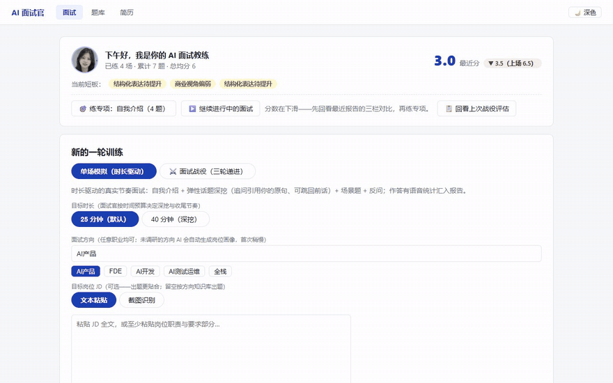
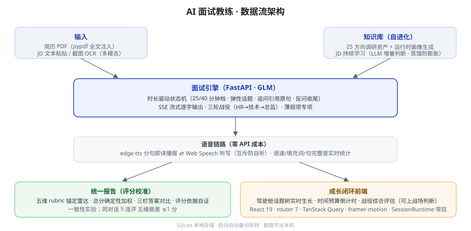
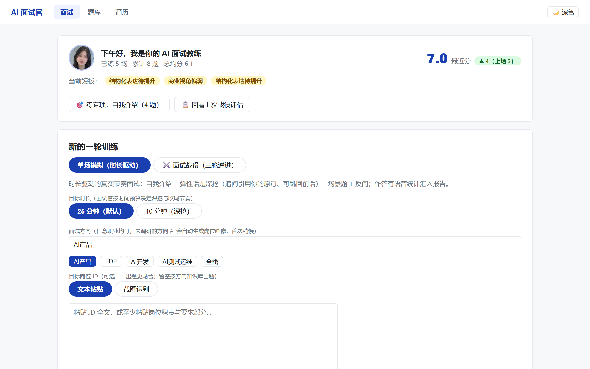

# AI 面试官 · job-copilot

> **本地单机运行的 AI 模拟面试教练**：上传简历 → 25/40 分钟语音对话式模拟面试 → 五维评分报告 → 薄弱项专项训练 → 三轮面试战役。
> 全程数据只存本地 SQLite，不上传第三方；不联网抓取任何招聘网站；自用零成本。

求职准备期，市面模拟面试产品按次收费、简历要传云端——所以我给自己造了一个。这是我以 AI 结对编程（vibe coding）方式主导开发的个人作品：产品定义、架构与技术决策由我完成，AI 负责结对实现，覆盖引擎、评分、语音链路到前端动效的完整闭环。

## 它长什么样

**沉浸面试间**——LLM 回答 SSE 流式逐字输出，分句即时转语音播报（edge-tts 神经音色）+ 声波律动；左侧话题树、右侧实时分析随对话生长：


**作答推进**——候选人作答后面试官针对原句追问（追问深度受时长预算约束），话题树实时长出新节点：


**五维评分报告**——统一量表达力/内容深度/结构化/岗位匹配/应变，雷达图 + 逐题复盘 + 「我的回答 / 参考要点 / AI 优化示范」三栏对比：



**三轮面试战役**——HR 面 → 技术面 → 总监面连续推进，跨轮追踪薄弱项出专项题，终出综合评估裁决：


## 架构



首页驾驶舱——教练问候、最近练习的话题树与实时指标、战役进度一屏可见：



## 技术叙事

**① 时长驱动的面试引擎**（`backend/services/interviewer.py`）
不是「问完 7 题就散」：会话以 25/40 分钟为预算，维护主问题/追问深度的状态机——追问安全上限 5 层、话题数随剩余时间弹性伸缩（真实节奏由时间预算决定），追问会引用候选人原句（「你刚才说 71 条规则，怎么保证不误杀？」）；满足「剩余 ≤5 分钟 / 面试官反问 / 已用 ≥70% 时长」任一条件才放行收尾，保证体验接近真实面试节奏。

**② 评分校准**（这是 LLM 应用最容易翻车的地方）
- 五维各写 **3/6/9 分锚点 rubric**，温度 0.1，要求模型输出 `grading_notes` 逐条引用作答原文佐证；
- 总分**不在 LLM 里算**：五维按固定权重（深度 0.30 / 岗位匹配 0.25 / 其余各 0.15）确定性加权，杜绝「这次总分 7 下次 6」的漂移；
- 一致性实验：同一段对话并行评分 5 次，五维极差全部 ≤1（两项为 0），总分极差 0.5。

**③ 知识库自进化**（`backend/services/knowledge.py`）
25 个方向的岗位调研文档（面试考点/高频题型/考察逻辑）作为出题底座；每场面试结束后把「候选人实际表现画像」合并进对应方向知识，超长（>8000 字）自动 LLM 蒸馏到 ~4000 字——练得越多，面试官越懂你的短板在哪。

**④ 语音链路**（听+说全双工）
说：LLM 流式输出走自定 SSE 协议（`<<<META>>>` 结构化元信息 + 正文），`SentenceBuffer` 按 sentence 分割即译即播，不用等全文；TTS 落盘缓存（上限 500 份，LRU 式按 mtime 轮转）。
听：Web Speech API 实时听写，识别结果可修改再提交——口述像真人面试，文字可修正口误。

**⑤ 前端架构**（React 19 + TS + Vite）
`SessionRuntime` 常驻根组件承载面试会话状态：SSE 连接跨路由切换不断线（面试中切去首页看驾驶舱指标，回来接着聊）；react-router 7 + TanStack Query 5 管路由与数据缓存；framer-motion 统一动效语言（180ms 快出快入、全站尊重 `prefers-reduced-motion`）；话题树/语速/填充词等实时指标全部从消息流本地派生，零额外请求。

## 量化指标

| 指标 | 数值 |
| --- | --- |
| 评分一致性（同对话 5 次并行评分） | 五维极差 ≤1，总分极差 0.5 |
| 单场成本（实测一场完整会话：首问 + 2 轮追问 + 报告，4 次调用） | ≈2.0 万 tokens，按 GLM 刊例价约 ¥0.2（订阅套餐内增量成本为 0） |
| 回归测试 | 20 个后端引擎单测 + 4 条前端 E2E 冒烟，全绿 |
| 知识库 | 25 个方向调研文档（约 7 万字），运行时持续自进化 |
| 数据安全 | 简历/会话仅存本地 SQLite，启动自动快照（保留 7 份） |

## 快速开始

```bash
# 1) 依赖：Python 3.12+ / Node 20+；智谱 API Key 放 backend/.env（ZHIPU_API_KEY=...）
# 2) 双击启动（Windows）：
start.bat
#    或手动：后端 http://127.0.0.1:9000（uvicorn）+ 前端 http://127.0.0.1:5173（vite）

# 回归测试（不调 LLM，秒级）
cd backend && .venv/Scripts/python.exe -m pytest tests/ -q
cd frontend && npx playwright test
```

## 目录结构

```
backend/
  main.py               # FastAPI 入口（启动备份/静态托管）
  services/
    interviewer.py       # 面试引擎：状态机/时长驱动/评分 rubric/报告生成
    knowledge.py         # 知识库合并 + 超长自动蒸馏
    tts.py               # edge-tts 合成 + 磁盘缓存轮转
  data/knowledge/*.md    # 25 方向岗位调研文档（随仓库提供）
  tests/                 # 20 个引擎纯逻辑单测（不调 LLM）
frontend/
  src/
    components/InterviewRoom.tsx   # 沉浸面试间（流式气泡/声波/话题树）
    components/cockpit/            # 驾驶舱：话题树/实时指标
    session.tsx          # SessionRuntime：SSE 跨路由常驻
  e2e/                   # Playwright 冒烟
docs/
  architecture.svg       # 架构图
  gifs/                  # 本 README 的演示动图
start.bat                # 一键启动
```

## 说明

- 个人求职作品：本地自用，不提供在线服务；除 LLM API 调用外不访问任何外部服务
- 技术栈：Python 3.12 · FastAPI · SQLAlchemy · SQLite ｜ Vite · React 19 · TypeScript · react-router 7 · TanStack Query 5 · framer-motion ｜ 智谱 GLM · edge-tts · Web Speech API
